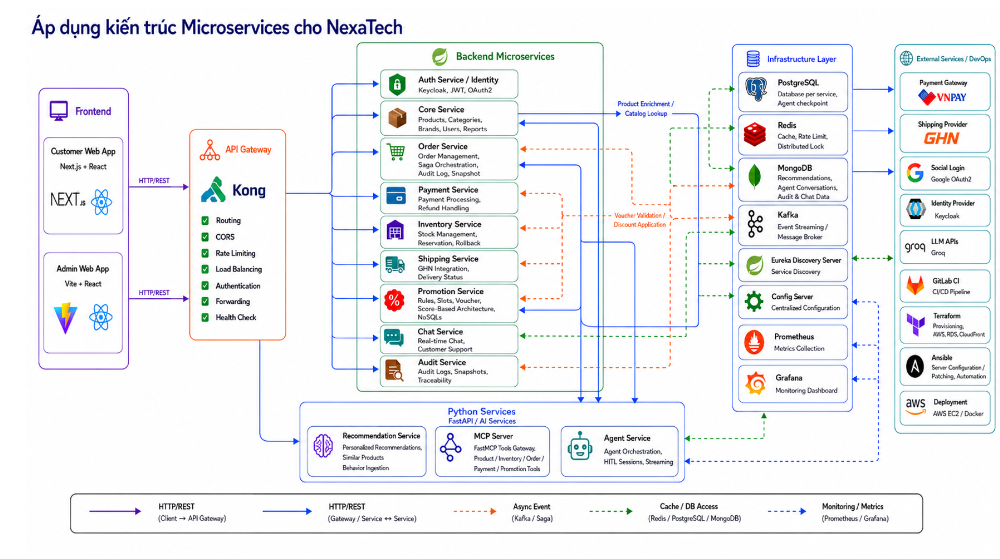
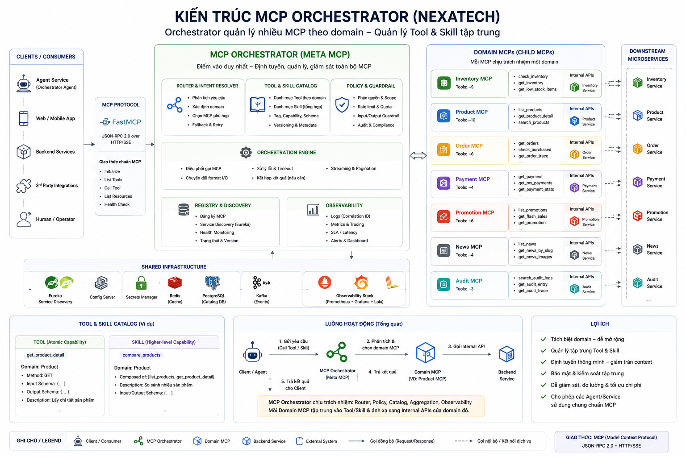
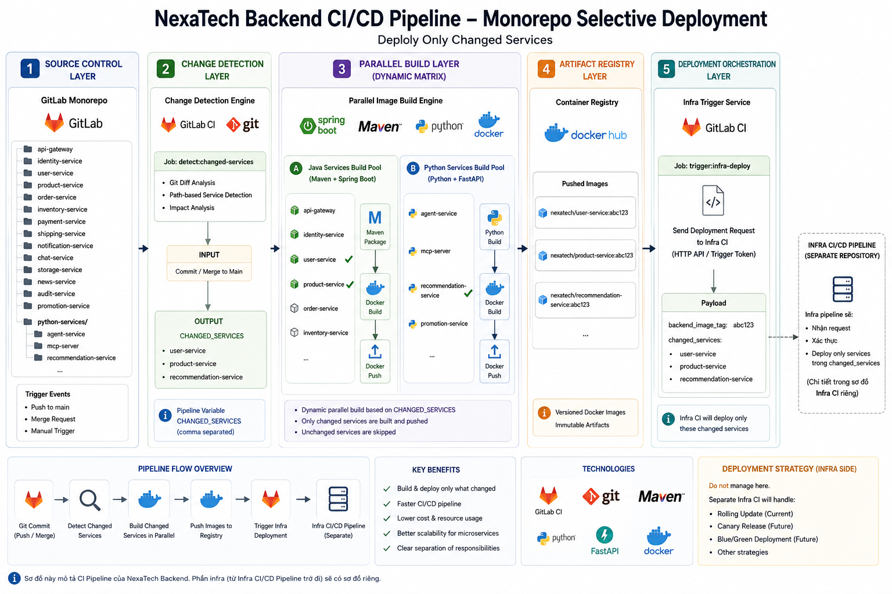
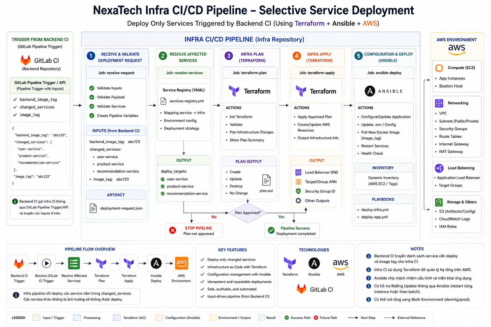

  

  <h1>NexaTech E-Commerce Platform</h1>

  
<strong>A Highly Scalable, Event-Driven Microservices Architecture</strong>

  

    
    
    
    
    
    
  

---

## 📌 Project Overview

NexaTech is a modern e-commerce ecosystem built with a focus on **scalability, resilience, and high performance**. The platform leverages a polyglot microservices architecture, combining the strengths of **Java (Spring Cloud)**, **Node.js (NestJS)**, and **Python (FastAPI)**.

This project is the result of intensive collaboration in the **Software Architecture and Design** course at **FIT – Industrial University of Ho Chi Minh City (IUH)**.

---

## 🏛️ Architectural Patterns

NexaTech implements several sophisticated architectural patterns to solve complex distributed systems challenges:

### 1️⃣ Microservices Architecture
- **Polyglot Services**: Leveraging the best tool for the job — Java (Spring Boot) for core business, Node.js (NestJS) for high-performance sub-systems, and Python (FastAPI) for AI/ML.
- **Service Mesh & Discovery**: Centralized routing via **Spring Cloud Gateway** and dynamic discovery with **Eureka**.
- **Database-per-Service**: Strict data isolation using PostgreSQL, MongoDB, and Redis tailored to each domain's needs.

### 2️⃣ Event-Driven Architecture (EDA)
- **Asynchronous Backbone**: **Apache Kafka** facilitates loosely coupled communication between services.
- **Transactional Outbox**: Ensures reliable message delivery and data consistency across distributed boundaries.
- **Event Sourcing**: Capturing state changes as a sequence of events for auditability and complex reactive workflows.

### 3️⃣ Space-Based Architecture (SBA)
- **High-Concurrency Processing**: Optimized for flash sales and peak traffic using **Redis** as a distributed "Space".
- **Atomic Operations**: Custom **Lua scripts** execute directly within the memory grid to ensure thread-safety and ultra-low latency without database bottlenecks.
- **In-Memory Data Grid**: Reducing read/write pressure on persistent stores by offloading hot-data transactions to the memory layer.

### 4️⃣ Pipeline Architecture
- **Data Processing Pipelines**: The **Recommendation Service** implements a multi-stage pipeline:
  1. **Collector**: Ingests user behavior events from Kafka.
  2. **Sync**: Normalizes and structures data for training.
  3. **Training**: Executes machine learning models (Collaborative Filtering, Ranking).
  4. **API / Serving**: Serves real-time personalized results through the gateway.
- **CI/CD Pipelines**: Fully automated Build → Test → Deploy flow using GitLab CI/CD, Terraform, and Ansible.

---

## 🏗️ System Architecture

### 🌐 High-Level Design
The system employs a centralized **API Gateway** as the single entry point, backed by **Service Discovery (Eureka)** and **Centralized Configuration (Spring Cloud Config)**. Communication between services is a mix of synchronous **REST APIs** and asynchronous **Event-Driven messaging** via **Kafka**.

### 🤖 AI-Powered Orchestration
NexaTech integrates advanced AI capabilities through a dedicated **MCP (Model Context Protocol) Orchestrator**, enabling intelligent search, recommendations, and agentic workflows.

---

## 🛠️ Tech Stack & Infrastructure

### **Core Technologies**
| Layer | Technologies |
|---|---|
| **Backend** | Java 21, Spring Boot 4, Spring Cloud, NestJS 11, FastAPI (Python 3.12) |
| **Frontend** | React 19, Next.js 15, Vite 8, TailwindCSS v4, React Native |
| **Data Stores** | PostgreSQL, MongoDB, Redis |
| **Messaging** | Apache Kafka (KRaft mode) |
| **Identity** | Keycloak 26.5.2 (OpenID Connect / OAuth2) |
| **DevOps** | Terraform 1.6+, Ansible, Docker Compose |
| **Cloud** | AWS (EC2, S3, RDS, ALB) |

---

## 📂 Repository Breakdown

| Repository | Description | Link |
|---|---|---|
| **📦 NexaTech Backend** | Core business logic, microservices, and API Gateway. | [View Repo](https://gitlab.com/software-architecture264301/nexatech-backend/) |
| **🎨 NexaTech Frontend** | Storefront (Next.js) and Admin Dashboard (React/Vite). | [View Repo](https://gitlab.com/software-architecture264301/nexatech-frontend) |
| **⚙️ NexaTech Infra** | Infrastructure as Code (Terraform) and Configuration Management (Ansible). | [View Repo](https://gitlab.com/software-architecture264301/nexatech-infra) |

---

## 🚀 CI/CD Pipelines

Our automation strategy ensures high code quality and seamless deployments across all environments.

### **Backend Pipeline**
Continuous integration for all polyglot microservices, including automated testing and Docker image builds.

### **Infrastructure Pipeline**
Automated provisioning of AWS resources using Terraform and configuration of environments with Ansible.

---

## 👥 Meet the Team

<table>
<tr>
<td align="center">
<a href="https://gitlab.com/giasinguyen">
 
<b>Nguyễn Trần Gia Sĩ</b>
</a> 
🎯 Team Lead 
Backend Developer
</td>
<td align="center">
<a href="https://gitlab.com/nvminh162">
 
<b>Nguyễn Văn Minh</b>
</a> 
🎨 Fullstack 
Fullstack Developer
</td>
<td align="center">
<a href="https://gitlab.com/nguyennguyen0">
 
<b>Nguyễn Trung Nguyên</b>
</a> 
⚙️ Devops & AI/ML 
API Developer
</td>
<td align="center">
<a href="https://gitlab.com/YezsuChiChoo">
 
<b>Đào Quốc Tuấn</b>
</a> 
🎨 Fullstack 
Fullstack Developer
</td>
</tr>
</table>

---

  <strong>Faculty of Information Technology – Industrial University of Ho Chi Minh City (IUH)</strong> 
  <em>Software Architecture and Design - 2026</em>

